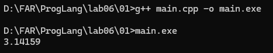
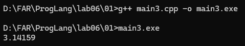
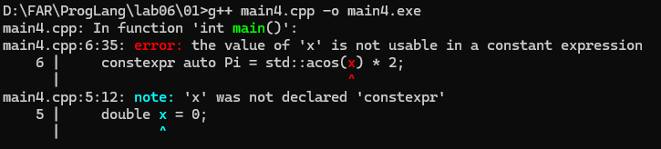
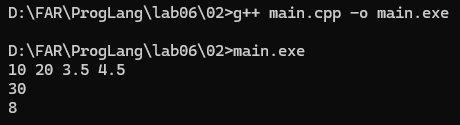
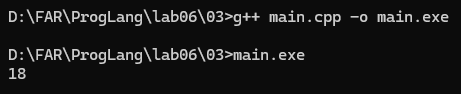
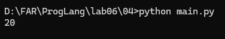
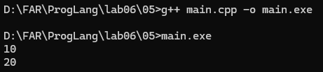
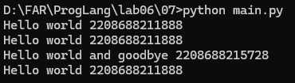
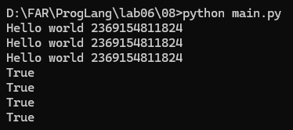
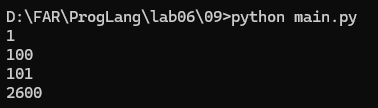

# Языки программирования

## Лабораторная работа 6

### Задание 1 **(3)**

*Рассмотрим следующую программу на С++.*

```cpp
#include <iostream>
#include <cmath>

int main() {
    double x = 0;
    const auto Pi = std::acos(0) * 2;
    std::cout << Pi << std::endl;
    return 0;
}
```

*Проверьте четыре способа объявления* **Pi**.

- `const auto Pi = acos(0) * 2;`
- `constexpr auto Pi = std::acos(0) * 2;`
- `const auto Pi = acos(x) * 2;`
- `constexpr auto Pi = std::acos(x) * 2;`

*Что можно сказать об этих вариантах? Проверьте, в каких вариантах объявляется константа этапа трасляции.*

*Тексты программ разместите в папке с номером задания*

**Решение**

#### Способ 1. `const auto Pi = acos(0) * 2;`

```cpp
#include <iostream>
#include <cmath>
int main() {
   double x = 0;
   const auto Pi = acos(0) * 2;
   std::cout << Pi << std::endl;
   return 0;
}
```



Переменная `Pi` получает значение числа Pi. Модификатор `const` запрещает изменять значение после инициализации, но сам по себе не гарантирует, что значение вычисляется на этапе трансляции.

#### Способ 2. `constexpr auto Pi = std::acos(0) * 2;`

```cpp
#include <iostream>
#include <cmath>
int main() {
   double x = 0;
   constexpr auto Pi = std::acos(0) * 2;
   std::cout << Pi << std::endl;
   return 0;
}
```


`constexpr` требует, чтобы значение вычислялось на этапе трансляции. В стандартах C++ до C++23 функция `std::acos` не являлась вычисляемой на этапе трансляции, поэтому этот вариант не компилируется. Начиная с C++23 он может компилироваться, если функция поддерживается компилятором как `constexpr`.

#### Способ 3. `const auto Pi = acos(x) * 2;`

```cpp
#include <iostream>
#include <cmath>
int main() {
   double x = 0;
   const auto Pi = acos(x) * 2;
   std::cout << Pi << std::endl;
   return 0;
}
```



Значение зависит от переменной `x`. Поскольку `x` не объявлена как константное выражение, вычисление не гарантируется на этапе трансляции. Однако значение `Pi` нельзя изменить после инициализации.

#### Способ 4. `constexpr auto Pi = std::acos(x) * 2;`

```cpp
#include <iostream>
#include <cmath>
int main() {
   double x = 0;
   constexpr auto Pi = std::acos(x) * 2;
   std::cout << Pi << std::endl;
   return 0;
}
```



Этот вариант не компилируется, поскольку `x` не является константным выражением. Для `constexpr` необходимо вычислить значение на этапе трансляции.

Таким образом `const` запрещает изменение значения переменной, а `constexpr` требует вычисления значения на этапе трансляции. Возможность компиляции второго варианта зависит от стандарта C++ и поддержки компилятором `constexpr`-функции `std::acos`.

### Задание 2 **(2)**

*Проверьте работу следующей программы на С++*

```cpp
#include <iostream>

int main() {
    {
        int x, y;
        std::cin >> x >> y;
        std::cout << x+y << std::endl;
    }
    {
        double x, y;
        std::cin >> x >> y;
        std::cout << x+y << std::endl;
    }
    return 0;
}
```

*Нужны ли в этой программе вложенные фигурные скобки? Дайте подробный ответ с объяснением причин.*



При вводе 10 20 3.5 4.5 программа выводит 30 и 8.

Да, вложенные фигурные скобки нужны, если мы хотим оставить переменные с одинаковыми именами x и y, но разными типами. Каждая пара фигурных скобок создаёт отдельную область видимости. Переменные, объявленные внутри блока, доступны только в пределах этого блока.

В первом блоке объявлены переменные x и y типа int. При вводе 10 20 программа складывает числа и выводит 30. После завершения блока эти переменные выходят из области видимости.

Во втором блоке объявляются новые переменные x и y типа double. При вводе 3.5 4.5 программа складывает числа и выводит 8.

Если убрать вложенные скобки, объявления окажутся в одной области видимости функции main. Компилятор выдаст ошибку, поскольку переменные с одинаковыми именами нельзя повторно объявить в той же области видимости.

Таким образом, вложенные фигурные скобки позволяют использовать одинаковые имена переменных для разных типов данных. Если убрать скобки, потребуется переименовать одну из пар переменных.

### Задание 3 **(2)**

*Проверьте работу следующего фрагмента программы на С++.*

```cpp
int s = 0;
for (int i = 0; i < 4; i++) {
    for (int i = 0; i < 3; i++) {
        s += i;
    }
    s += i;
}
std::cout << s;
```



*В результате каких вычислений был получен ответ? Дайте подробный ответ.*

В программе используется две переменные `i` с одинаковыми именами. В C++ внутренняя переменная `i` существует только внутри внутреннего цикла. Поэтому после его завершения используется внешняя переменная `i`.

Внутренний цикл выполняется три раза: при `i = 0`, `i = 1` и `i = 2`.

За один проход внутреннего цикла к `s` прибавляется:

`0 + 1 + 2 = 3`

Внешний цикл выполняется четыре раза. При каждом проходе внутренний цикл прибавляет к `s` число 3. Дополнительно после внутреннего цикла прибавляется значение внешней переменной `i`.

Вычисления по проходам внешнего цикла:

- Первый проход: `s = 0 + 3 + 0 = 3`.
- Второй проход: `s = 3 + 3 + 1 = 7`.
- Третий проход: `s = 7 + 3 + 2 = 12`.
- Четвёртый проход: `s = 12 + 3 + 3 = 18`.

**Ответ: 18.**

В C++ переменные с одинаковыми именами могут существовать в разных областях видимости. Внутренняя переменная скрывает внешнюю только внутри своей области видимости.

### Задание 4 **(2)**

*Проверьте работу следующего фрагмента программы на* **Python**.

```python
s = 0
for i in range(4):
    for i in range(3):
        s += i
    s += i
print(s)
```



*В результате каких вычислений был получен ответ? Дайте подробный ответ.*

*На основе этих примеров поясните различия между* **С++** *и* **Python** *при работе с переменными.*

В Python переменная `i` во внутреннем цикле использует то же имя, что и переменная внешнего цикла. При этом внутренний цикл изменяет значение `i`, и после его завершения оно равно 2.

Внутренний цикл выполняется три раза. При каждом проходе к `s` прибавляются значения `0`, `1` и `2`:

`0 + 1 + 2 = 3`

После внутреннего цикла к `s` дополнительно прибавляется `i`, равное 2.

Вычисления по проходам внешнего цикла:

- Первый проход: `s = 0 + 3 + 2 = 5`.
- Второй проход: `s = 5 + 3 + 2 = 10`.
- Третий проход: `s = 10 + 3 + 2 = 15`.
- Четвёртый проход: `s = 15 + 3 + 2 = 20`.

**Ответ: 20.**

В C++ переменная, объявленная внутри цикла, имеет отдельную область видимости и не изменяет внешнюю переменную с таким же именем. В Python переменная цикла не получает отдельную область видимости, поэтому внутренний цикл изменяет значение `i`, которое используется после его завершения.

### Задание 5 **(2)**

*Напишите свой пример программы на* **С++**, *создающий и использующий пространства имен. Программа должна содержать не менее двух пространств имен.*

```cpp
#include <iostream>

namespace First {
    int a = 10;
}

namespace Second {
    int a = 20;
}

int main() {
    std::cout << First::a << std::endl;
    std::cout << Second::a << std::endl;

    return 0;
}
```



Программа содержит два пространства имён: `First` и `Second`. В каждом пространстве объявлена переменная `a`, но значения у них разные. С помощью оператора `::` можно обратиться к переменной из нужного пространства имён: `First::a` выводит `10`, а `Second::a` — `20`. Пространства имён позволяют использовать одинаковые имена переменных без конфликтов.

### Задание 7 **(2)**

*Рассмотрим программу на языке* **Python**.

```python
a = 'Hello world'
print(a, id(a))
b = a
print(b, id(b))
a += ' and goodbye'
print(a, id(a))
print(b, id(b))
```

*Объясните ее работу. В какой момент создавались строки? Что означает значение, возвращенное функцией* **id**?



В первой строке создаётся строка `'Hello world'`, и переменная `a` получает ссылку на неё. Функция `id()` возвращает идентификатор объекта, который позволяет отличать его от других объектов во время выполнения программы.

При выполнении `b = a` переменная `b` начинает ссылаться на тот же объект, что и `a`. Поэтому значения `id(a)` и `id(b)` совпадают.

При выполнении `a += ' and goodbye'` создаётся новая строка `'Hello world and goodbye'`, поскольку строки в Python неизменяемы. Переменная `a` начинает ссылаться на новую строку, а `b` продолжает ссылаться на первоначальную строку `'Hello world'`.

Поэтому после изменения `a` переменная `b` сохраняет прежнее значение, а идентификатор объекта, на который ссылается `a`, отличается от идентификатора объекта, на который ссылается `b`.

Получается переменные Python хранят ссылки на объекты. При присваивании `b = a` новая строка не создаётся, а обе переменные ссылаются на один объект. При добавлении текста создаётся новая строка, поскольку существующую строку нельзя изменить.

### Задание 8 **(2)**

*Пусть* **a** *- строковая переменная в программе на* **Python**. *Есть ли разница между работой присваивания* `b = a` *и* `b = a[:]` *Напишите программу для демонстрации различий.*

В Python строки являются неизменяемыми объектами. При выполнении `b = a` переменная `b` получает ссылку на тот же объект, что и `a`.

Выражение `a[:]` создаёт срез строки от начала до конца. Для строк Python обычно возвращает тот же объект при полном срезе, поэтому в данном случае обе операции не имеют существенного различия.

```python
a = 'Hello world'

b = a
c = a[:]

print(a, id(a))
print(b, id(b))
print(c, id(c))

print(a == b)
print(a == c)

print(a is b)
print(a is c)
```



Оператор `==` проверяет равенство значений, а оператор `is` — принадлежность переменных одному и тому же объекту. В обычной реализации Python для приведённой программы все три переменные будут ссылаться на один объект строки.

Для строк присваивание `b = a` и полный срез `b = a[:]` дают одинаковое значение. В отличие от списков, строки нельзя изменить по отдельным элементам, поэтому создавать независимую копию для безопасного изменения содержимого не требуется.

### Задание 9 **(3)**

*Напишите программу на языке* **Python**, *которая создаст 2600 переменных с именами от* **a0** *до* **a99**, *от* **b0** *до* **b99** *и так далее, от* **z0** *до* **z99**. *Присвойте всем переменным различные значения от 1 до 2600.*

```python
n = 1

for c in "abcdefghijklmnopqrstuvwxyz":
    for i in range(100):
        name = c + str(i)
        globals()[name] = n
        n += 1

print(a0)
print(a99)
print(b0)
print(z99)
```



Переменная `n` хранит очередное значение, начиная с 1. Первый цикл перебирает буквы от `a` до `z`, а второй цикл перебирает числа от 0 до 99.

Команда `str(i)` превращает число в текст, а `c + str(i)` объединяет букву и число в имя, например `a0` или `b15`.

Команда `globals()[name] = n` создаёт переменную с полученным именем и присваивает ей значение `n`. После каждого создания переменной значение `n` увеличивается на единицу.

Всего создаётся 26 * 100 = 2600 переменных. Каждая получает уникальное значение от 1 до 2600.